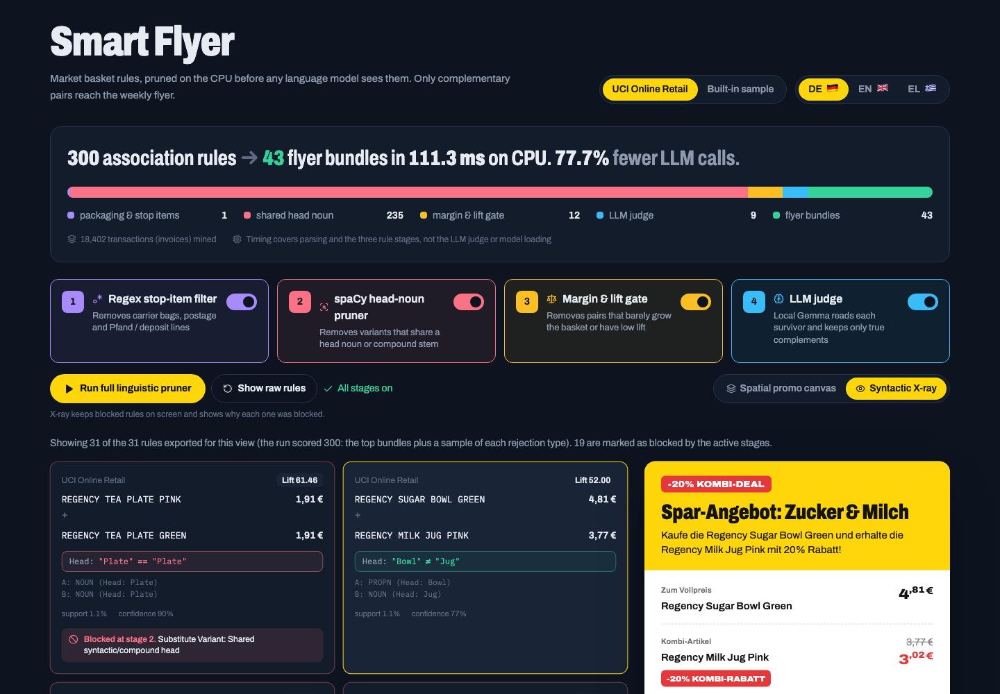

# Smart Flyer: what computational linguistics adds to a small LLM

**Result:** pooled over 324 held-out product pairs, rules and a small local LLM together beat either one alone (F1 0.62 vs. 0.51 for the LLM and 0.49 for the rules),
because each catches what the other misses. Linguistic checks with repair also nearly double the flyer texts that two blind AI raters would print (27 % to 50 %).
Two things I expected failed: the rules saved 30 % of LLM calls rather than 50 %, and writing copy with placeholders did not help (20 % vs. 27 % publishable, and worse in German).

The setting is a promotion pipeline. Market basket analysis finds products bought together, but many pairs are useless for a flyer: substitutes
(*white T-light holder + red T-light holder*, where a discount only moves sales around) and operational lines (postage, deposit).
Someone or something has to pick the real bundles and write the copy. Here that is `gemma4:e2b-it-qat`, 4.6B parameters, on an 8 GB laptop.


The interactive showcase in this repository:



## Bundle decisions


Is a pair a good cross-sell bundle? Positive class: complement. Pooled over three held-out sets; each row is measured on the same pairs.

| Pipeline | Precision | Recall | F1 (95 % CI) | LLM calls |
|---|--:|--:|--:|--:|
| LLM only | 0.36 | 0.88 | 0.51 (0.43–0.58) | 324 |
| Rules only | 0.33 | 0.94 | 0.49 (0.42–0.56) | 0 |
| **Rules + LLM** | 0.46 | 0.81 | 0.59 (0.51–0.66) | 227 |
| LLM with the parser's analysis in its prompt | 0.41 | 0.86 | 0.55 (0.48–0.63) | 324 |
| **Rules + LLM with the parser's analysis** | 0.51 | 0.80 | 0.62 (0.54–0.70) | 227 |

**They fail in opposite places.** What each method blocked (a higher share is better for the first two rows, and a lower one for the last):

| Gold class | LLM only | Rules only | Rules + LLM |
|---|--:|--:|--:|
| substitute (127): blocked | 37 % | 66 % | 74 % |
| not a bundle (117): blocked | 61 % | 7 % | 62 % |
| complement (80): wrongly blocked | 13 % | 6 % | 19 % |

Form shows when two products are the same kind of thing (*Vollmilch / Hafermilch*, *jumbo bag / jumbo bag*). It can't show that a T-light holder and a lunch bag
have nothing to do with each other; for that you need meaning, and the small LLM has some sense of it. On its own, though, Gemma called 63 % of the substitutes good bundles.

**Per set (F1):**

| Set | LLM only | Rules only | Rules + LLM | Rules + LLM + analysis | Calls saved |
|---|--:|--:|--:|--:|--:|
| `t1` Same shop, a year earlier, new pairs (n = 98) | 0.46 | 0.46 | 0.67 | 0.70 | 54 % |
| `t2` Other domain: real grocery receipts, category names (n = 106) | 0.33 | 0.26 | 0.36 | 0.41 | 7 % |
| `t3` German shelf names, constructed (n = 120) | 0.64 | 0.70 | 0.70 | 0.71 | 31 % |

**Stability.** Swapping the two product names changed Gemma's verdict on 26 of 100 pairs, and on 14 with the parser's analysis in the prompt.
Changing the letter case changed it on 18. The rules changed on none, under either test.

## Flyer copy

30 bundles in German, English and Greek. Publishable means two blind AI raters (two large LLMs from the same family) both said they would print the text unchanged.

| Condition | All | English | German | Greek | Written by the LLM | Calls |
|---|--:|--:|--:|--:|--:|--:|
| Raw LLM output | 27 % | 50 % | 20 % | 10 % | 100 % | 30 |
| **Linguistic checks + targeted repair** | 50 % | 83 % | 40 % | 27 % | 98 % | 90 |
| Placeholders `[A]` `[B]` + checks | 20 % | 60 % | 0 % | 0 % | 100 % | 30 |

Only 39 % of first drafts passed all checks. The commonest faults, out of 90 texts: invented promises such as "today only" (37), changed product names (35), a wrong or extra number (13),
Greek words that don't exist (13). Greek stays too weak to print without a person, so the pipeline uses templates for Greek by default.

**A gap found after the study (2026-11-12).** The study's checks never tested the direction of the offer. Run over the study's texts, the
working pipeline's direction check finds 10 of 90 checked texts, and at least 8 of 90 raw ones (35 raw texts changed the product names, so the check cannot place them), that make the customer pay full price for the discounted
item ("Buy the cake cases and get 20 % off the doilies" when the doilies are the full-price anchor). Both raters rejected all 18, so no
published number changes, but `pipeline/copy_checks.py` now catches them and sends them back for repair. The check follows which
product the buy cue points at ("buy", "when you buy", "Kaufe", "beim Kauf von", "wenn du … kaufst", "με την αγορά"); "get" and "hol dir"
name what you take home, so they are not buy cues; a buy word right after a name ("Red Mug purchase", "wer Müsli kauft") points back at it.

**The placeholder method failed, in an instructive way.** The model saw only `[A]` and `[B]`, so it wrote one sentence for all 30 bundles. That sentence passed every check, and raters rejected it:
the German says "ist 20% Rabatt". Rule checks verify facts and form, not whether a sentence is good German. Read this as one sentence rated thirty times, not as thirty tests.
A version that shows the model the product names was not tested.

## Pre-registered hypotheses

Written before any test data existed: [`experiments/PREREGISTRATION.md`](experiments/PREREGISTRATION.md). Full tables: [`experiments/results/REPORT.md`](experiments/results/REPORT.md).

| | Hypothesis | Estimate (95 % CI) | Outcome |
|---|---|---|---|
| H1 | Rules + LLM use ≥ 50 % fewer calls, and F1 is not worse | 30 % fewer calls; F1 +0.078 (+0.04 to +0.12) | **Not supported** (F1 is better, the saving falls short) |
| H2 | Rules + LLM have higher precision than the LLM alone | +0.101 (+0.06 to +0.14), Holm p 0.0008 | Supported |
| H3 | The LLM adds value to the rules (F1) | +0.097 (+0.05 to +0.15), Holm p 0.0012 | Supported |
| H4 | The parser's analysis helps the LLM (F1) | +0.047 (+0.01 to +0.08), Holm p 0.011 | Supported |
| H5 | The parser's analysis makes verdicts more stable under a swap | −12 points (17 vs. 5 discordant pairs), Holm p 0.017 | Supported |
| H6 | Checks + repair raise the publishable share | +23 points (+12 to +34), p 0.0002 | Supported |
| H7 | Placeholders raise the publishable share | −7 points (−18 to +4), p 0.24 | **Not supported** |

A more cautious check resamples products rather than pairs, because pairs share products. There, the F1 gain of rules + LLM over the LLM alone holds (+0.004 to +0.158) and so does its precision gain (+0.034 to +0.200),
while H3 (−0.013 to +0.193) and H4 (−0.016 to +0.106) become inconclusive.

## How the experiment was run

1. **Plan first.** Hypotheses, conditions and statistics were written before the test sets were mined.
2. **Held-out data.** `t1` is UCI Online Retail II, 2009–10 (34 pairs that re-describe tuning products were removed before labelling, amendment A1). `t2` is `Groceries` from R's arules: 9,835 real receipts. `t3` is 120 German pairs written by an LLM that never saw the rules. It is constructed, not real shopping data.
3. **Blind labels.** Two annotators (two large LLMs from the same family) labelled every pair from an [annotation guide](eval/ANNOTATION_GUIDE.md), with different row orders and no view of the rules, the model output or each other. A third resolved the 18 test-set disagreements. Cohen's kappa over three classes: `t1` 0.84, `t2` 0.82, `t3` 0.99.
4. **Rule freeze.** The rules were tuned once on the tuning sets only, then frozen with a checksum (`experiments/frozen/`) before any test scoring.
5. **A fair baseline.** Three prompts for the LLM were compared on tuning data, and the best one (with examples) was used. Temperature 0, fixed seed, no unreadable answers.
6. **Blind rating.** Two raters scored 270 texts with the condition hidden (kappa on publishable 0.76).
7. **Independent check.** A separate LLM agent recomputed the counts, metrics, pair-level CIs, agreement, flip rates and copy shares from raw files with its own code, without reading the analysis: 594 checks, no discrepancy ([`experiments/verify/VERIFICATION.md`](experiments/verify/VERIFICATION.md)). A second script (`verify_gap.py`) recomputed the H6/H7 CIs and the Holm values: 29 of 30 checks within tolerance. The miss is the German H7 lower bound, −0.367 vs. −0.333, which is Monte Carlo noise on a discrete distribution and doesn't change the conclusion. The item-level CIs were not recomputed.

## What the rules do, in linguistic terms

**Stop items.** A regex for operational lines. On the tuning data, the bare `\bbag\b` of a first version removed 160 bags the shop *sells* (lunch bag, jumbo bag), so "bag" only counts after plastic, paper, carrier or shopping, or alone. German hides stop words inside compounds (*Flaschenpfand*), so those are matched at the end of a word.

**Head nouns.** `spaCy` on bare catalog names goes wrong: *ALARM CLOCK BAKELIKE GREEN* gets the head *Green*, *Bio Fettarme Milch* gets *Bio*, and *Grillkohle* is tagged VERB. So:

- **Normalise:** title-case ALL-CAPS lines; strip units, counts and variant attributes (colours, sizes, marketing labels).
- **Learn attributes from the catalog with minimal pairs.** Descriptions that differ in one slot show which words are interchangeable: *LUNCH BAG ALPHABET DESIGN / LUNCH BAG APPLE DESIGN*. Fillers mostly seen in the final slot are kept, because that slot is the head (*PINK CRYSTAL NECKLACE / BRACELET* are product types). This is distributional analysis in the structuralist sense.
- **Head per language.** English noun phrases are head-final, so the head is the root of the last noun chunk before the first preposition or conjunction. German shelf names lead with the product, so the head is the first noun, found by parsing inside a carrier sentence (*Ich kaufe …*), which fixes the tagger.

**Same kind of product?** Same head, or one head ends in the other (*Milch / Vollmilch*). German closed compounds: a shared ending of 5+ letters (*Vollmilch / Hafermilch*), or a short base from a small list (*Apfelsaft / Orangensaft*). English open compounds: the same leading or trailing two words (*HAND WARMER …*, *… METAL SIGN*), or the same three words anywhere (*HOT WATER BOTTLE*). The 5-letter rule isn't used for English because it would merge *holder* and *folder*.

## Run it

```bash
python3.11 -m venv .venv && .venv/bin/pip install -r requirements.txt
.venv/bin/python -m spacy download en_core_web_sm
.venv/bin/python -m spacy download de_core_news_sm
.venv/bin/python -m spacy download el_core_news_sm

.venv/bin/python pipeline/export_smart_flyer.py --no-llm                        # built-in sample, rules and templates, ~1 s → out/
.venv/bin/python pipeline/export_smart_flyer.py --csv data/raw/OnlineRetail.csv --model gemma4:e2b-it-qat  # real data, judge and copy → public/smart_flyer_data.json
.venv/bin/python -m pytest -q

npm install && npm run dev                                                      # the interactive showcase
```

A run on the built-in sample writes `out/smart_flyer_sample_run.json` and never touches the files the showcase ships with; pass `--out` to choose another path. UCI data: [Online Retail](https://archive.ics.uci.edu/dataset/352/online+retail) (the `.xlsx` works directly). Without Ollama the pipeline falls back to rules and fixed templates and never crashes. `--no-llm-judge`, `--gemma-greek` and `--strict-spec-regex` switch single stages. One run on the tuning data took 300 pairs to 43 bundles (1 stop item, 235 shared heads, 12 margin & lift, 9 by the LLM judge; telemetry in `public/smart_flyer_data.json`). That is what the showcase displays; the evaluation numbers are the held-out ones above.

**Reproduce the study:** `experiments/build_testsets.py`, `apply_t1_audit.py`, `merge_gold.py`, then `zsh experiments/run_all_llm.sh` (about 35 minutes, resumable), `analyze.py`, `export_site_data.py`, `verify/verify_numbers.py`. Follow-up utilities: `experiments/human_audit.py` (`--batches` for the two 50-pair batches and the browser app, `--sample`, `--interactive`, `--score`) for human spot-checks against the silver-standard labels, and `experiments/run_copy.py --delex-context` for placeholder copy with product names in the prompt.

```
pipeline/export_smart_flyer.py, copy_checks.py   the product pipeline (cascade + guarded copy)
src/components/SmartFlyerShowcase.tsx            React + Tailwind + motion/react + lucide-react showcase
experiments/                                     the study: plan, harness, results, verification
eval/                                            annotation guide, blind labels, ratings
```

## Data and licences

The code is MIT ([`LICENSE`](LICENSE)). The raw data is not part of this repository; only product names, pairs and the labels derived from it are.

- **`dev`:** Chen, D. (2015). *Online Retail* [Dataset]. UCI Machine Learning Repository. <https://doi.org/10.24432/C5BW33>. CC BY 4.0.
- **`t1`:** Chen, D. (2012). *Online Retail II* [Dataset]. UCI Machine Learning Repository. <https://doi.org/10.24432/C5CG6D>. CC BY 4.0.
- **`t2`:** `Groceries`, provided by Michael Hahsler, Kurt Hornik and Thomas Reutterer with the R package [arules](https://cran.r-project.org/package=arules) (GPL-3). Hahsler, Hornik & Reutterer (2006), *Implications of probabilistic data modeling for mining association rules*. Read from a public copy; its address and checksum are in `data/testsets/manifest.json`.
- **`dev_de` and `t3`:** constructed for this project, not real shopping data.

Changes to the UCI and Groceries data: cleaned, mined for product pairs, filtered and labelled (`experiments/build_testsets.py`).

## Limits

- **Silver standard.** Annotators and raters are large LLMs, not people. They can share blind spots with each other, and with the LLM that wrote `t3`. One annotator labelled obviously identical bag pairs in bulk. **Human check (amendment A3, after the results):** the author labelled 100 test pairs blind (two batches of 50 in `eval/human/label_pairs.html`) with the same guide. Agreement with the AI gold is kappa 0.69 over three classes (79 %): `t3` 0.96, `t1` 0.60, `t2` 0.37. Most disagreements (13 of 21) are pairs the gold calls not a bundle and the author calls a complement. 11 of these are everyday groceries in `t2` (milk + butter, milk + eggs), where the guide's food rule says "not a bundle" unless there is a concrete use, so the human applied that rule less strictly than the AI annotators did. Re-scored against the human labels on these 100 pairs, the cascade's precision gain over the LLM alone holds (+0.14, CI [+0.04, +0.25]; silver +0.13). Its F1 gain is smaller (+0.02 against +0.06; both CIs include 0 at this size). One author is not an outside annotator, and the reported results stay as run. Details: `experiments/results/REPORT.md`, last section; `eval/human/human_labels_report.json`.
- **One small model on one laptop.** No claim is made about large models, which may need rules less for accuracy. Latency is indicative; calls and tokens are the cost measures.
- **Modest sizes.** 80 complements in the test sets; the per-set CIs are wide. Pairs share products, so the pair-level CIs are optimistic, as the item-level check shows.
- **`t3` is constructed**, and `t1` shares its vocabulary with the tuning data, so the `t1` gain is the most flattering one. `t2` is the hardest and least flattering: best F1 0.41.
- **Rule costs & post-study refinements.** Rules can reject true complements: a cup and saucer (*Tasse / Untertasse*) look like variants. In the frozen study snapshot (`experiments/frozen/export_smart_flyer_v1.py`), *Passierte Tomaten* got a wrong head (`passierte`), 3-letter German bases outside the list (*Apfelmus / Pflaumenmus*) were missed, and cross-boundary open compounds (*CHARLOTTE BAG DOLLY GIRL DESIGN / RED RETROSPOT CHARLOTTE BAG*) slipped through; the working product pipeline (`pipeline/export_smart_flyer.py` and `pipeline/copy_checks.py`) fixes all three and adds an offer-direction check so the discounted and full-price items cannot be swapped in copy.
- **"Margin" is basket revenue.** `promo_bundle_price ≥ 1.10 × anchor price` is equivalent to complement price ≥ 12.5 % of the anchor. True margin needs cost data, which UCI doesn't have. The gate is a business rule and is excluded from the evaluation. UCI prices are GBP, converted at 1.16.
- **Checks can't judge language.** See the placeholder result.
