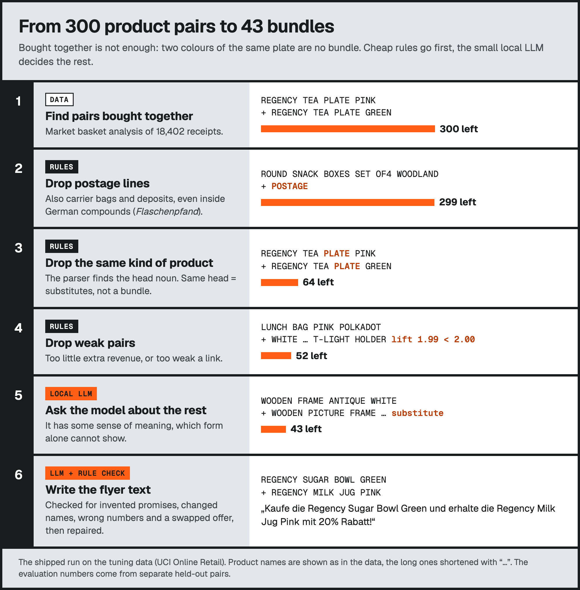
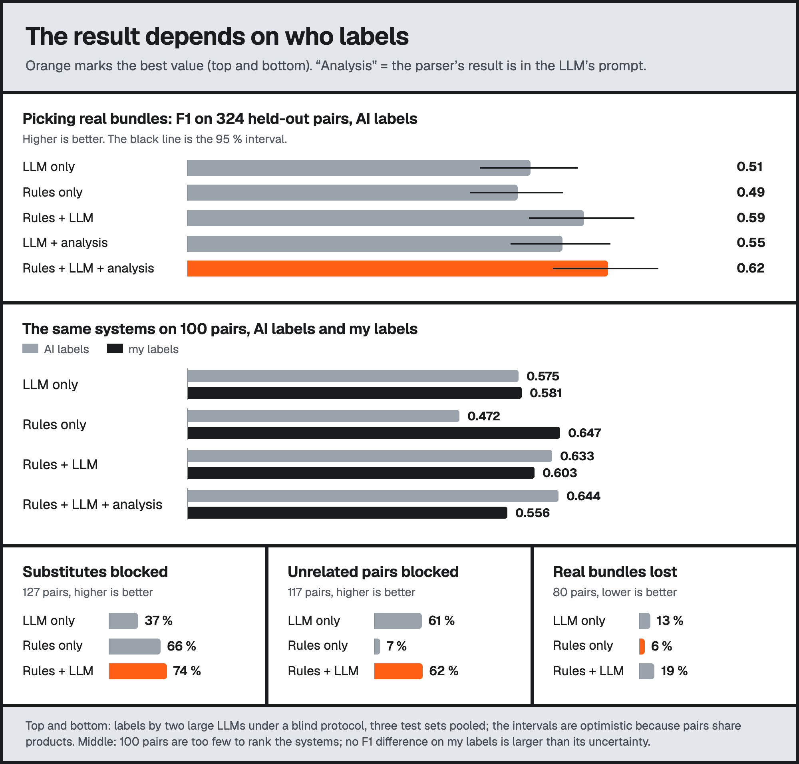
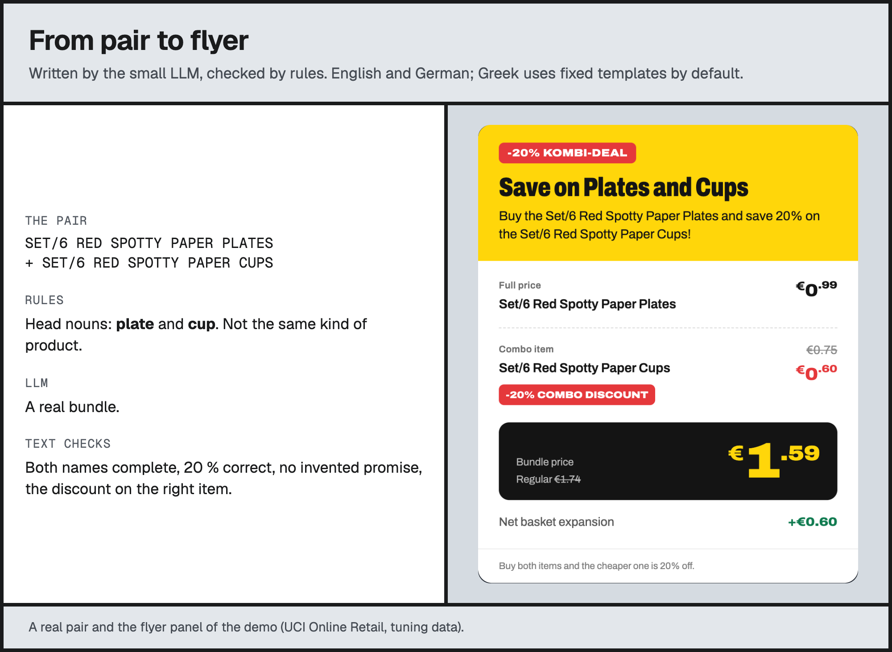

# Smart Flyer

Which products belong together in a flyer, and who writes the text? This project tests what computational linguistics adds to a **small
language model that runs on a laptop** (`gemma4:e2b-it-qat`, 4.6B parameters, 8 GB).

**In one paragraph.** On 324 held-out product pairs **labelled by AI annotators**, linguistic rules plus the LLM with the parser's analysis
in its prompt score F1 0.62, against 0.51 for the LLM alone and 0.49 for the rules alone (plain rules + LLM: 0.59). **On 100 of these pairs
that I labelled myself, that order does not hold:** rules alone score highest. 100 pairs are too few to rank the systems, so read the main
result as a result on AI labels.

## The problem

Market basket analysis finds products that are bought together. Many of these pairs are useless for a flyer: two colours of the same
T-light holder are *substitutes* (a discount only moves sales around), and postage or deposit is no product at all. Someone has to pick the
real bundles and write the text.

## How it works



The rules look at form: which word is the head of a product name, which German compounds share an ending (*Vollmilch / Hafermilch*). That
shows when two products are the same kind of thing. It cannot show that a T-light holder and a lunch bag have nothing to do with each
other; for that, the small LLM has some sense of meaning. The rules go first, so the LLM sees fewer pairs.

## Results

### Picking bundles



- **They fail in different places.** The LLM alone blocks 37 % of the substitutes, the rules 66 %. The rules block 7 % of the unrelated
  pairs, the LLM 61 %.
- **The price:** rules + LLM also lose more real bundles (19 %) than the LLM (13 %) or the rules (6 %).
- **Calls:** the rules saved 30 % of the LLM calls. I had predicted 50 %.

### The human check

The same 100 pairs, the same predictions, two sets of labels:

| System | F1, AI labels | F1, my labels |
|---|--:|--:|
| LLM only | 0.575 | 0.581 |
| Rules only | 0.472 | **0.647** |
| Rules + LLM | 0.633 | 0.603 |
| Rules + LLM with the parser's analysis | **0.644** | 0.556 |

I accept more pairs than the AI annotators do, above all everyday groceries such as milk and butter (38 bundles against 25; agreement 79 %,
kappa 0.69). None of the F1 differences on my labels is larger than its uncertainty. What holds on both sets of labels: rules + LLM are
**more precise** than the LLM alone (+0.14 on mine, +0.12 on the AI labels). More: [docs/STUDY.md](docs/STUDY.md#the-human-check-100-pairs-after-the-results).

### Writing the flyer text



Two blind AI raters judged 270 texts in German, English and Greek. Linguistic checks with targeted repair raise the share that both would
print from 27 % to 50 %, **using three times as many LLM calls** (90 instead of 30). Greek stays too weak to print without a person (27 %).
Writing with placeholders instead of product names did not help (20 %).

Checks verify facts and form, not sense. One shipped flyer is headed *Zucker & Milch* and sells a sugar bowl and a milk jug; it passed every
check.

## Run it

```bash
python3.11 -m venv .venv
.venv/bin/pip install -r requirements.txt
.venv/bin/python -m spacy download en_core_web_sm
.venv/bin/python -m spacy download de_core_news_sm
.venv/bin/python -m spacy download el_core_news_sm

# built-in sample, rules and templates, about 1 second
.venv/bin/python pipeline/export_smart_flyer.py --no-llm
.venv/bin/python -m pytest -q

# the interactive demo
npm install && npm run dev
```

With Ollama and the [UCI data](https://archive.ics.uci.edu/dataset/352/online+retail), add `--csv data/raw/OnlineRetail.csv --model
gemma4:e2b-it-qat`. Without Ollama the pipeline uses rules and fixed templates.

The demo shows one run on the **tuning data**. Its "77.7 % fewer LLM calls" belongs to that run; on the held-out pairs the saving was 30 %.

## Limits

- **AI labels.** The main result rests on labels by two large LLMs from the same family, not on people. See the human check above.
- **Small test sets.** 80 real bundles in all. When products instead of pairs are resampled, the gain of rules + LLM over the LLM alone holds,
  but the gain over the rules alone does not (inconclusive).
- **One small model on one laptop.** Nothing is claimed about larger models.
- **The German set is constructed**, and the set closest to the tuning data gives the most flattering result.
- Five of seven pre-registered hypotheses were supported; the call saving and the placeholders failed. All of them, the method and the rules
  in detail: [docs/STUDY.md](docs/STUDY.md).

## Data and licences

The code is MIT ([`LICENSE`](LICENSE)); the third-party data below is not covered by it. The raw data is not part of this repository; only product names, pairs and the labels derived from it are.

- **`dev`:** Chen, D. (2015). *Online Retail* [Dataset]. UCI Machine Learning Repository. <https://doi.org/10.24432/C5BW33>. CC BY 4.0.
- **`t1`:** Chen, D. (2012). *Online Retail II* [Dataset]. UCI Machine Learning Repository. <https://doi.org/10.24432/C5CG6D>. CC BY 4.0.
- **`t2`:** `Groceries`, provided by Michael Hahsler, Kurt Hornik and Thomas Reutterer with the R package [arules](https://cran.r-project.org/package=arules) (GPL-3). Hahsler, Hornik & Reutterer (2006), *Implications of probabilistic data modeling for mining association rules*. Read from a public copy; its address and checksum are in `data/testsets/manifest.json`.
- **`dev_de` and `t3`:** constructed for this project, not real shopping data.

Changes to the UCI and Groceries data: cleaned, mined for product pairs, filtered and labelled (`experiments/build_testsets.py`).
